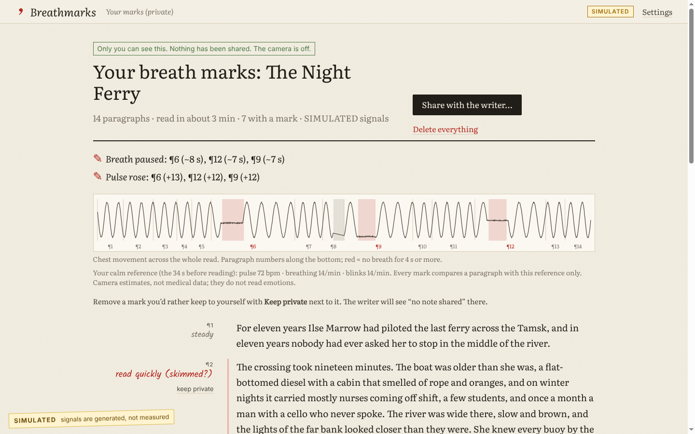
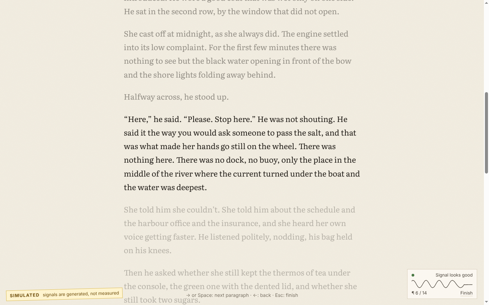
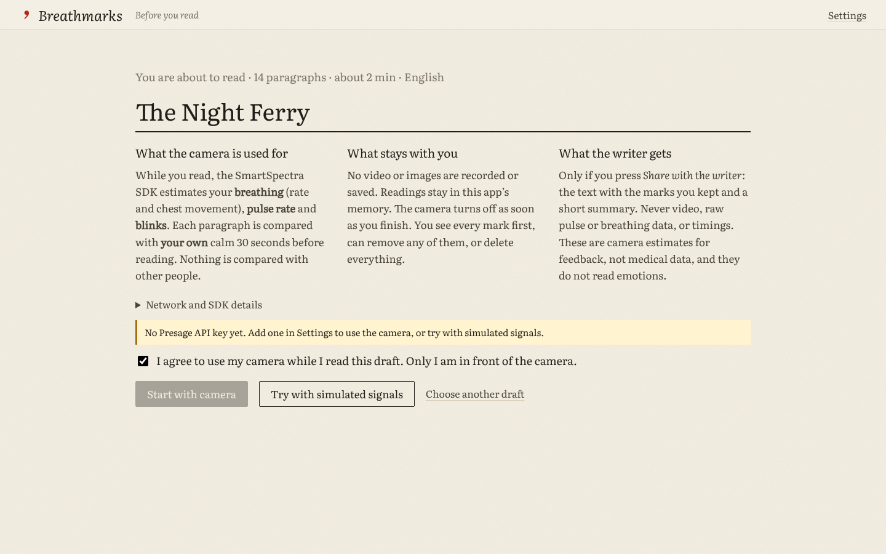
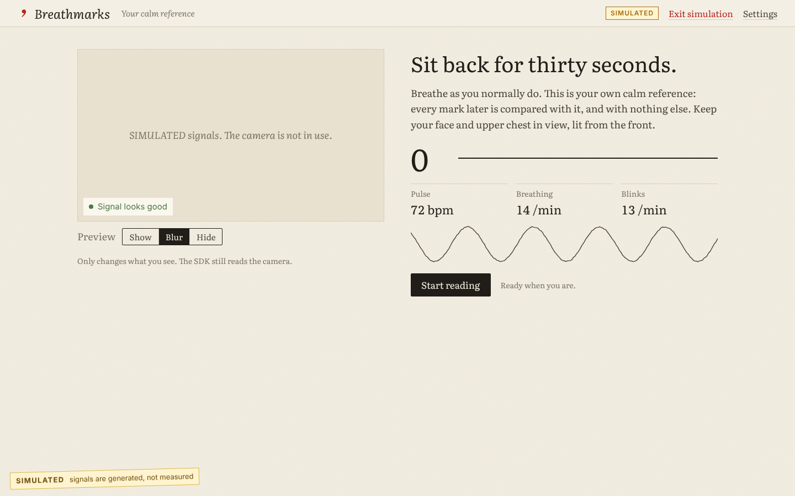
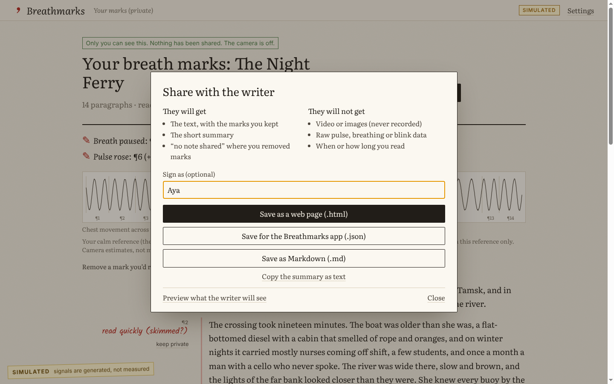
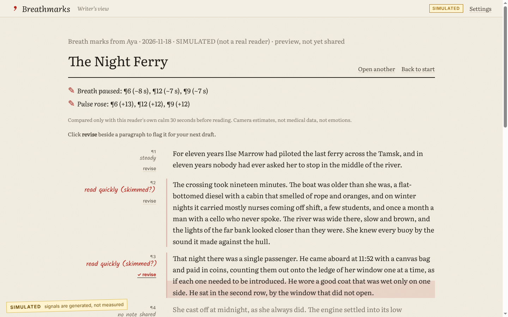
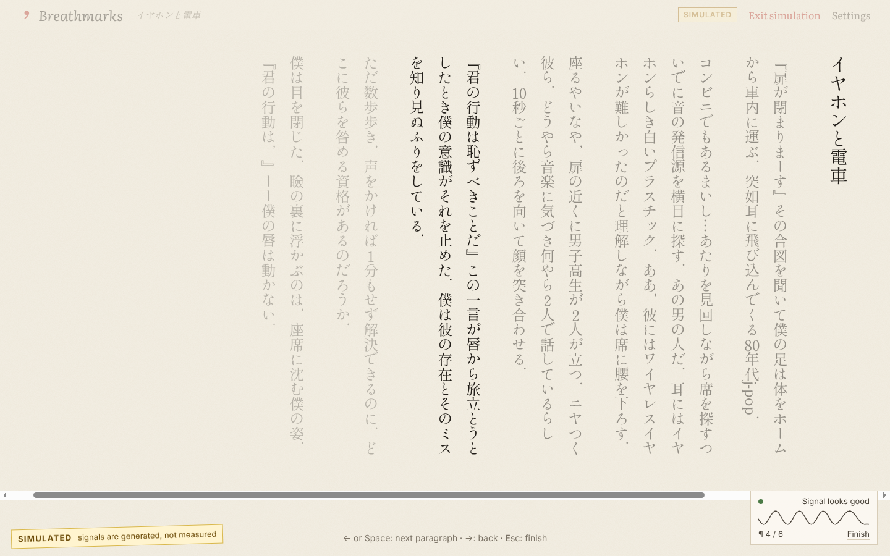
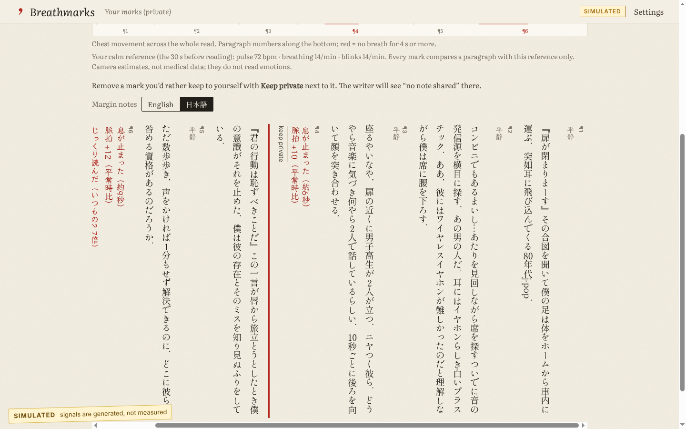

# Breathmarks

**Your friends are too kind to tell you chapter 3 drags. Their breathing isn’t.**

Breathmarks is a beta-reading desk for fiction writers. A friend reads your draft silently on their laptop. The [Presage SmartSpectra SDK](https://smartspectra.presagetech.com/) reads their **breathing**, **pulse rate** and **blinks** from the webcam, paragraph by paragraph, and compares each paragraph only with **that reader’s own calm 30 seconds** before reading. The reader sees the resulting margin marks first, removes any they want to keep private, and only then shares them with you.

Scroll analytics tell you where readers left. Breathmarks shows where they held their breath.



> Built for the [DEV Presage SmartSpectra SDK Challenge](https://dev.to/challenges/presage-2026-11-04). Electron + `@smartspectra/node-sdk` 3.5.0. Screenshots in this README use the app’s **SIMULATED** mode (scripted signals, labelled on screen).

## How it works

| Step | Who | What happens |
| --- | --- | --- |
| Open the draft | reader | Open the `.txt` / `.md` file the writer sent, paste text, or try a bundled sample. Project Gutenberg headers are stripped. Japanese text can be read in vertical layout (縦書き, with 1–2 digit numbers set upright). |
| Agree | reader | Plain-language consent: what the camera is used for, what stays on the computer, what the writer gets. The camera is off until the box is ticked. |
| Calm reference | reader | 30 seconds of good signal, sitting still. Pulse, breathing rhythm and blink rate become this reader’s reference. The preview is blurred by default. |
| Read | reader | One paragraph in focus at a time (→ / Space / click; ← / → swapped in vertical mode). A small corner indicator shows signal status and a thin live chest-movement line. Nothing else interrupts. |
| Review (private) | reader | The camera turns off. The reader sees a summary, a strip of their breathing across the whole read, and the manuscript with handwritten-style margin notes. **Keep private** removes a note; **Delete everything** discards the reading. For Japanese drafts the notes can be shown in English or Japanese. |
| Share | reader | Save a self-contained web page, a `.breathmarks.json` for the app, or Markdown, or copy a text summary. Nothing reaches the writer without this step. |
| Writer’s view | writer | Open the `.json` (or the web page). Flag paragraphs to **revise**. |



| | |
| --- | --- |
|  |  |
|  |  |
|  |  |

## How it responds to human signals

Requested from the SDK (hand-picked codes, data minimisation): `CHEST_BREATHING`, `ABDOMEN_BREATHING`, `BREATHING_RATE`, `PULSE_RATE`, `BLINKING`, `TALKING`. Not requested: expressions, face landmarks, HRV, arterial pressure trace.

All logic is in [`src/core/reading.js`](src/core/reading.js) and is unit-tested.

- **Breath pauses ("no breath for ~N s")** — the chest-movement trace (`breathing.upperTrace`) is detrended; breaths are found as upward crossings with hysteresis, scaled to the reader’s own calm breath size. A pause is a gap between breaths longer than both 1.8 × the calm breath period and period + 4 s, *and* containing a stretch of ≥ 4 s where the raw trace barely moves (range within ±1 s below 25 % of a calm breath). Gaps that overlap “no face” time or speech are ignored. (The SDK’s own apnea field is documented as unavailable in 3.5.0, so this is computed in the app.)
- **Breathing rate per paragraph** — breaths counted from the trace while that paragraph was on screen (≥ 10 s on screen), compared with the calm rhythm. The SDK’s breathing *rate* is a 30-second average, too coarse for one paragraph, so it is only shown live during the calm reference.
- **Pulse** — median of the SDK’s stable `PULSE_RATE` samples from 2 s after the paragraph appears to 6 s after it leaves (the SDK reports a ~12 s average), minus the calm median. Marked at ±6 bpm.
- **Blinks** — onsets in `face.blinking`, per minute on screen, compared with the calm rate; only when the calm rate predicts at least 5 blinks for that paragraph.
- **Pace** — time on screen per word (or per character for Japanese) relative to this reader’s own median pace: “lingered (1.7× usual time)”, “read quickly (skimmed?)”.
- **Looked away** — the SDK’s validation status `NO_FACE_FOUND` for ≥ 3 s on a paragraph.
- **Steady** — enough signal and nothing above. Shown honestly; most paragraphs of most drafts are steady.

The wording is deliberately descriptive. Breathmarks never says a paragraph was exciting, scary or boring, and never compares one reader with another.

## Consent and data handling

- **Camera**: on only after the reader ticks the consent box; only video (no microphone) and only for the bundled local page (Electron permission handler). It turns off when reading ends or **Stop camera** is pressed.
- **Video**: frames are processed by the SDK on this computer. The app never records or saves video or images. The preview can be shown, blurred (default) or hidden.
- **Readings**: kept in memory only. The app writes nothing to disk except the report the reader chooses to save in the Share dialog.
- **What the writer receives**: the text, the kept margin notes and the summary. Not raw pulse/breathing/blink series, not timestamps or reading time, not video. Removed notes appear as “no note shared”.
- **Deletion**: **Delete everything** on the review screen. Closing the app also discards everything not exported.
- **Network**: the SDK contacts Presage to verify the API key and meter usage. SDK telemetry is **off** by default (Settings switch). Presage documents that when breathing and cardio metrics are active the SDK may send pulse and breathing *numbers* to its insights gateway; Breathmarks never calls `requestInsight`. Turning off Pulse in Settings avoids this. See [Telemetry & Privacy](https://smartspectra.presagetech.com/docs/telemetry-and-privacy) and the [Presage Privacy Policy](https://api.physiology.presagetech.com/privacypolicy).
- **API key**: stored encrypted with Electron `safeStorage`, or read from `SMARTSPECTRA_API_KEY`. Handed to the renderer only after camera consent. Never written into project files.
- **Not medical, not emotion detection**: these are camera estimates used as reading feedback. No diagnosis, no health claims.

## Setup

Requirements: Node.js 22.12 or newer, a webcam, and a free Presage developer API key from [physiology.presagetech.com](https://physiology.presagetech.com/auth/register).

```bash
git clone <this repo>
cd breathmarks
npm install
npm start
```

Then **Settings → Presage API key → Save key**, open a draft (or a sample), tick the consent box and press **Start with camera**.

- Without a key: **Try with simulated signals** runs the whole flow with scripted values, labelled SIMULATED everywhere (including exported files).
- `npm run start:sim` starts with the camera disabled.
- `npm test` runs the analysis tests (paragraph parsing, baseline, pause detection, reader-controlled export).
- `npm run screenshots` regenerates `docs/screenshots/` from the simulated mode (`xvfb-run -a npm run screenshots` on a headless Linux box).
- On Windows, start the app from PowerShell rather than the VS Code terminal.

Free-tier note: Presage’s free tier is metered in credits (1 credit = 30 s of live measurement). A typical read of the bundled sample with the calm reference uses about 6–8 credits.

## Project layout

```
main.js                 Electron main: window, SDK IPC binding, consent-gated camera permission, key storage, export dialog
src/preload.js          SDK preload bridge + small window.breathmarks API
src/live/liveSource.js  SmartSpectra renderer SDK wrapper (requested metrics, errors)
src/sim/simulator.js    SIMULATED source (encodes with the SDK's own Metrics protobuf)
src/core/signals.js     Accumulates decoded metrics into time series
src/core/reading.js     Manuscript parsing, baseline, breath/pause detection, marks, shareable report
src/renderer/app.js     Screens and flow
src/samples.js          Sample texts (see Credits)
fonts/                  Literata, Kalam, Shippori Mincho (subset), Klee One (subset) — SIL OFL 1.1
```

## Credits

- Presage SmartSpectra SDK and its Electron quickstart sample.
- Fonts (SIL Open Font License 1.1, via Fontsource): Literata (The Literata Project Authors), Kalam (Indian Type Foundry), Shippori Mincho (The Shippori Mincho Project Authors) and Klee One (The Klee Project Authors). The Japanese fonts are subset to JIS X 0208 level-1 kanji, kana and symbols (Shippori Mincho) and to the characters of the Japanese margin notes (Klee One); other characters fall back to the system mincho.
- “The Night Ferry” was written for this project with AI assistance and is released under CC0 (`samples/the-night-ferry.txt`).
- “The Lost Property Office” was also written for this project with AI assistance and is released under CC0 (`samples/the-lost-property-office.txt`). It is the draft read in the demo video; the reader saw it for the first time on camera.
- 「イヤホンと電車」 is a short story by the app’s author, included as a sample. It is not covered by the MIT licence. The original is one paragraph; here it is split into six paragraphs at sentence ends (．) only, with the text otherwise unchanged.
- Built with help from an AI coding assistant (Claude).

MIT License (code). Sample texts: see Credits.
